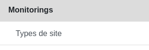
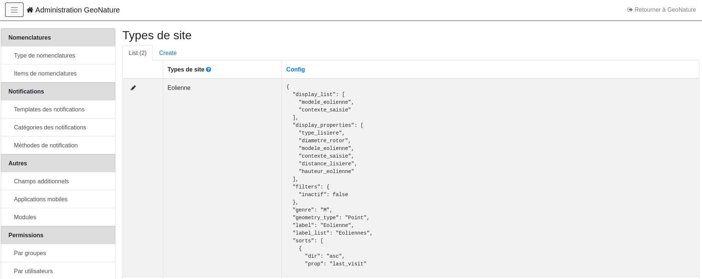
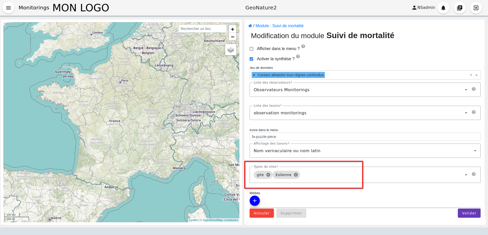

# Création d'un sous-module

> [!IMPORTANT]
> Lors de la création d'un sous-module, le nom du dossier (resp. le code du sous-module) doit respecter [les normes de nommage des tables dans une base de données PostgreSQL](https://www.postgresql.org/docs/current/sql-syntax-lexical.html). Les règles sont les suivantes :
>
> - contient moins de 63 caractères
> - doit commencer par une lettre
> - ne doit contenir que des lettres, des chiffres, ou des underscores `_`.

## Structure d'un sous-module

### Les fichiers de configuration

| Fichier                   | Rôle                                                                                            |
| ------------------------- | ----------------------------------------------------------------------------------------------- |
| `config.json`             | Configuration générale                                                                          |
| `module.json`             | Configuration du sous-module                                                                    |
| `site.json`               | Configuration des sites                                                                         |
| `sites_group.json`        | Configuration des groupes de sites                                                              |
| `visit.json`              | Configuration des visites                                                                       |
| `observation.json`        | Configuration des observations                                                                  |
| `observation_detail.json` | Configuration des détails des observations                                                      |
| `nomenclature.json`       | Ajout de nomenclatures spécifiques au sous-module                                               |
| `synthese.sql`            | Vue pour la synchronisation avec la synthèse (voir [Intégration dans la synthèse](synthese.md)) |
| `img.jpg`                 | Vignette du sous-module sur la page d'accueil du module Monitoring                              |

Pour chaque fichier, les valeurs prises par défaut sont celles du fichier de même nom présent dans le répertoire `config/monitoring/generic`.

Le fichier `img.jpg` servira de vignette du sous-module sur la page d'accueil du module Monitoring. Le format paysage est à privilégier. Un lien symbolique est créé automatiquement dans le répertoire `media/monitorings/<module_code>.jpg` de GeoNature.

### Les types de sites

S'ajoutent à ces fichiers des configurations de **types de sites**, que l'on devra associer aux sous-modules installés.

Pour cela, il faut créer les types de sites via l'interface administrateur (voir les deux images ci-dessous).

<details><summary>Images représentant l'interface administrateur au niveau du menu « Types de site »</summary>





</details>

Ces types de sites, une fois créés, pourront être associés au sous-module dans la configuration du sous-module.

<details open><summary>Image représentant la configuration du sous-module avec l'association aux types de sites</summary>



</details>

### Le dossier des exports

```
exports/
├── csv/   # fichiers SQL définissant les vues des exports CSV
└── pdf/   # fichiers html/img/css du template de l'export PDF
```

- `csv/` : les vues doivent être nommées `v_export_<module_code>_<method>`, où `<method>` est une chaîne de caractères permettant de distinguer différentes vues et différents exports pour un sous-module.
- `pdf/` : ces fichiers définissent un template pour l'export PDF et tous les assets nécessaires (images, style, etc.).

Voir la section [Exports](#exports) pour leur configuration.

## Configuration générale

Dans le fichier `config.json`, la variable `tree` définit les relations entre les objets :

```json
{
  "tree": {
    "module": {
      "site": {
        "visit": {
          "observation": {
            "observation_detail": null
          }
        }
      }
    }
  }
}
```

## Configuration des objets

Dans le fichier `module.json`, deux variables doivent obligatoirement être définies :

- `module_code` : un nom court, en minuscules et simple, par exemple `cheveches` ou `oedic` pour les protocoles chevêches ou oedicnèmes.
- `module_desc` : une description succincte du sous-module.

Dans le cas général (`module.json`, `site.json`, `visit.json`, `observation.json`), on peut redéfinir au besoin certaines variables :

- `label` : permet de nommer les objets, par exemple `"Site"` pour un site ;
- `description_field_name` : le nom du champ qui servira à décrire l'objet (pour son titre), par exemple :
  - `"visit_date_min"` pour une visite,
  - `"base_site_name"` pour un site ;
- `geometry_type` : pour les sites seulement, peut prendre la valeur `Point`, `LineString` ou `Polygon` ;
- `b_draw_sites_group` : pour spécifier si l'on veut afficher un contour autour des sites d'un groupe de sites. Ce paramètre est également configurable dans l'interface de configuration du sous-module.

Les variables `display_properties` et `display_list` indiquent quelles variables seront affichées, et dans quel ordre (respectivement sur la page d'un objet et dans les listes). Si `display_list` n'est pas défini, il prend la valeur de `display_properties`.

Par exemple :

```json
"display_properties": [
  "visit_date_min",
  "observers",
  "meteo",
  "comments",
  "nb_observations"
]
```

### Les schémas génériques

Les schémas des variables génériques sont définis dans le répertoire `config/monitoring/generic`, dans les fichiers correspondant aux objets et dans la variable `generic`.

Pour la suite, nous prendrons exemple sur la configuration des sites, qui est similaire aux autres objets dans les grandes lignes.

Par exemple, dans le fichier `site.json` de ce répertoire, on trouve la variable `generic` :

```json
"id_base_site": {
  "type_widget": "text",
  "attribut_label": "Id site",
  "hidden": true
},
"id_module": {
  "type_widget": "text",
  "attribut_label": "ID Module",
  "hidden": true
}
```

Chaque entrée de la variable `generic` est le nom d'une variable (`"id_base_site"`, `"id_nomenclature_type_site"`, etc.).

- Attributs obligatoires :
  - `type_widget` : renseigne à la fois sur la nature de la variable et sur son type d'input. Pour plus de détails sur les différentes possibilités, voir [Définir une nouvelle variable](#définir-une-nouvelle-variable).
  - `attribut_label` : associe un nom à la variable, comme `"Type de site"` pour `id_nomenclature_type_site`.
- Attributs facultatifs :
  - `hidden` : permet de cacher la variable ou l'input du formulaire
  - `value` : permet d'attribuer une valeur par défaut
  - `required` : permet de rendre un input obligatoire
  - `definition` : permet d'ajouter une définition à la variable pour aider l'utilisateur
- Attributs spéciaux :
  - `type_util` : peut prendre pour valeur `"user"`, `"nomenclature"`, `"dataset"` ou `"taxonomy"`. Permet d'indiquer qu'il s'agit d'un identifiant (exemple : nomenclature) et de traiter cette variable en fonction.

On peut utiliser comme valeur de ces attributs des données de la configuration du sous-module, avec les variables suivantes :

- `__MONITORINGS_PATH`
- `__MODULE.ID_LIST_TAXONOMY`
- `__MODULE.MODULE_CODE`
- `__MODULE.ID_MODULE`
- `__MODULE.ID_LIST_OBSERVER`
- `__MODULE.TAXONOMY_DISPLAY_FIELD_NAME`
- `__MODULE.TYPES_SITE`
- `__MODULE.IDS_TYPES_SITE`
- `__MODULE.CD_NOM`

Elles peuvent servir dans la définition des formulaires (en particulier pour les [datalists](#datalists)).

#### Liste des widgets disponibles

| Widget         | Commentaire                                                                    |
| -------------- | ------------------------------------------------------------------------------ |
| `text`         | Texte sur une seule ligne                                                      |
| `textarea`     | Texte sur plusieurs lignes                                                     |
| `radio`        | Choix unique parmi plusieurs                                                   |
| `select`       | Liste de choix unique                                                          |
| `time`         | Heure                                                                          |
| `number`       | Nombre                                                                         |
| `multiselect`  | Liste de choix multiples                                                       |
| `html`         | Insertion d'un bloc HTML                                                       |
| `nomenclature` | Liste avec vocabulaire contrôlé de GeoNature                                   |
| `taxonomy`     | Sélection d'un taxon                                                           |
| `observers`    | Sélection d'un observateur                                                     |
| `date`         | Sélection d'une date                                                           |
| `datalist`     | Liste dont les items sont fournis par une API (externe ou interne à GeoNature) |

#### Liste des paramètres disponibles par type de widget

| Widgets                                 | Paramètre                | Commentaire                                                                                                                                       |
| --------------------------------------- | ------------------------ | ------------------------------------------------------------------------------------------------------------------------------------------------- |
| Tous                                    | `attribut_label`         | Label du formulaire                                                                                                                               |
| Tous                                    | `definition`             | Ajoute une infobulle avec le contenu de ce paramètre (le paramètre `link_definition` ne doit pas être défini)                                     |
| Tous                                    | `required`               | Booléen : permet de rendre cet input obligatoire                                                                                                  |
| Tous                                    | `hidden`                 | Booléen : permet de cacher un champ du formulaire                                                                                                 |
| Tous                                    | `link_definition`        | Ajoute un lien vers l'adresse pointée par ce paramètre. Le paramètre `definition` doit également être défini                                      |
| Tous                                    | `pattern_message`        | Ajoute un texte en rouge sous le champ explicitant une erreur                                                                                     |
| Tous                                    | `value`                  | Valeur par défaut du champ                                                                                                                        |
| select / multiselect / checkbox / radio | `values`                 | Valeurs de choix proposées. Attend un tableau de valeurs ou un tableau clé/valeur `[{"value": "my_database_value", "label": "my_display_value"}]` |
| select                                  | `noNullOption`           | Désactive la valeur vide (« - ») des choix d'un select                                                                                            |
| number                                  | `min`                    | Valeur minimum de l'input                                                                                                                         |
| number                                  | `max`                    | Valeur maximum de l'input                                                                                                                         |
| nomenclature                            | `code_nomenclature_type` | Code du type de nomenclature à afficher                                                                                                           |
| nomenclature                            | `cd_nomenclatures`       | Liste des codes nomenclatures à afficher (afin d'éliminer certains items que l'on ne veut pas pour ce sous-module)                                |
| nomenclature / dataset / observers      | `multi_select`           | Booléen : permet de sélectionner plusieurs items dans la liste de valeurs                                                                         |
| dataset                                 | `module_code`            | Limite aux jeux de données associés à ce sous-module                                                                                              |
| html                                    | `html`                   | Contenu du bloc HTML                                                                                                                              |

### Définir une nouvelle variable

Pour définir une nouvelle variable, ou redéfinir une caractéristique d'une variable générique, il faut créer une variable nommée `specific` dans les fichiers `site.json`, `visit.json` ou `observation.json` afin de définir le schéma spécifique de cet objet.

#### Texte

Une variable facultative :

```json
"nom_contact": {
  "type_widget": "text",
  "attribut_label": "Nom du contact"
}
```

#### Entier

Exemple avec un numéro de passage obligatoire, compris entre 1 et 2 :

```json
"num_passage": {
  "type_widget": "number",
  "attribut_label": "Numéro de passage",
  "required": true,
  "min": 1,
  "max": 2
}
```

#### Utilisateur

Il est possible de choisir des observateurs de deux manières différentes : soit les observateurs sont issus d'une liste d'observateurs (champ `observers`), soit on renseigne textuellement une liste d'observateurs (champ `observers_txt`).

```json
"observers": {
  "attribut_label": "Observateurs",
  "type_widget": "observers",
  "type_util": "user",
  "code_list": "__MODULE.ID_LIST_OBSERVER",
  "hidden": false,
  "required": true
},
"observers_txt": {
  "hidden": true,
  "required": false
}
```

Par défaut, c'est la liste d'observateurs liée au sous-module qui est utilisée. Pour renseigner plutôt des observateurs textuellement, il suffit d'inverser les valeurs de `hidden` et `required` entre `observers` et `observers_txt`.

> [!WARNING]
> Il est important d'ajouter `"type_util": "user"`.

#### Nomenclature

Un choix obligatoire parmi une liste définie par un type de nomenclature :

```json
"id_nomenclature_nature_observation": {
  "type_widget": "nomenclature",
  "attribut_label": "Nature de l'observation",
  "code_nomenclature_type": "OED_NAT_OBS",
  "required": true,
  "type_util": "nomenclature"
}
```

La variable `"code_nomenclature_type": "OED_NAT_OBS"` définit le type de nomenclature.

> [!WARNING]
> Il est important d'ajouter `"type_util": "nomenclature"`.

#### Liste

Une liste déroulante simple, non basée sur une nomenclature :

```json
"rain": {
  "type_widget": "select",
  "required": true,
  "attribut_label": "Pluie",
  "values": ["Absente", "Intermittente", "Continue"]
}
```

Il est possible de définir une valeur présélectionnée avec le paramètre `value` (exemple : `"value": "Absente"`).

#### Radio

Bouton radio pour un choix unique parmi plusieurs possibilités :

```json
"beginner": {
  "type_widget": "radio",
  "attribut_label": "Débutant",
  "values": ["Oui", "Non"]
}
```

#### Taxonomie

Une liste de taxons :

```json
"cd_nom": {
  "type_widget": "taxonomy",
  "attribut_label": "Taxon",
  "type_util": "taxonomy",
  "required": true,
  "id_list": "__MODULE.ID_LIST_TAXONOMY"
}
```

La variable `"id_list": "__MODULE.ID_LIST_TAXONOMY"` définit la liste de taxons.

> [!WARNING]
> Il est important d'ajouter `"type_util": "taxonomy"`.

#### Jeu de données

Une liste de jeux de données :

```json
"id_dataset": {
  "type_widget": "dataset",
  "attribut_label": "Jeu de données",
  "type_util": "dataset",
  "required": true,
  "module_code": "__MODULE.MODULE_CODE"
}
```

La variable `"module_code": "__MODULE.MODULE_CODE"` permet de sélectionner uniquement les jeux de données associés au sous-module.

> [!WARNING]
> Il est important d'ajouter `"type_util": "dataset"`.

### Redéfinir une variable existante

Dans plusieurs cas, on peut avoir besoin de redéfinir un élément du schéma. On ajoute alors cet élément dans la variable `specific`, et il sera mis à jour.

> [!TIP]
> **Ordre de priorité.** Pour un même objet, la configuration finale combine, du moins au plus prioritaire :
>
> 1. les champs génériques (`generic`) fournis par le module Monitoring ;
> 2. pour les sites, les champs définis sur les types de sites (module Admin) ;
> 3. les champs `specific` du fichier JSON du sous-module.
>
> Exception : pour un champ de site défini à la fois sur un type de site et dans `site.json`, c'est la valeur du type de site qui l'emporte.
>
> Si un champ redéfini dans `specific` porte **le même `type_widget`** que le champ générique, il le remplace entièrement : il faut alors redéfinir tous ses attributs. Sinon (sans `type_widget`, ou avec un autre), ses attributs sont fusionnés avec ceux du champ générique.

**Changer le label d'un élément, et le rendre visible et obligatoire :**

```json
"visit_date_max": {
  "attribut_label": "Date de fin de visite",
  "hidden": false,
  "required": true
}
```

**Donner une valeur par défaut à une nomenclature et cacher l'élément :**

Ici, `type_widget` est redéfini avec une autre valeur que celle du champ générique : les attributs indiqués sont fusionnés avec ceux du champ générique.

```json
"id_nomenclature_sex": {
  "type_widget": "text",
  "attribut_label": "Sexe",
  "type_util": "nomenclature",
  "value": {
    "code_nomenclature_type": "SEXE",
    "cd_nomenclature": "6"
  },
  "hidden": true
}
```

Il est important d'ajouter `"type_util": "nomenclature"`. Pour renseigner la valeur de la nomenclature, on spécifie :

- le type de nomenclature `"code_nomenclature_type"` (correspond au champ `mnemonique` du type)
- le code de la nomenclature `"cd_nomenclature"`

**Donner au composant « type de site » les types de sites définis dans le sous-module comme valeur par défaut, et cacher l'élément :**

```json
"types_site": {
  "default": "__MODULE.IDS_TYPE_SITE",
  "hidden": true
}
```

### `datalists`

Pour créer des composants de type select à partir d'une API, on peut utiliser le widget `datalist`.

Options supplémentaires pour ce widget :

| Option        | Description                                                                                                    |
| ------------- | -------------------------------------------------------------------------------------------------------------- |
| `api`         | API qui fournit la liste                                                                                       |
| `application` | `GeoNature` ou `TaxHub` : préfixe l'API avec l'URL de l'API de l'application                                   |
| `keyValue`    | Champ renvoyé                                                                                                  |
| `keyLabel`    | Champ affiché                                                                                                  |
| `type_util`   | `nomenclature`, `dataset`, `user` : pour le traitement des données par ailleurs                                |
| `data_path`   | Si l'API renvoie les données sous la forme `data: [<les données>]`, alors `data_path = "data"`                 |
| `filters`     | Filtre les données reçues (`{field_name: [value1, value2, ...]}`)                                              |
| `default`     | Valeur par défaut (`"default": {"cd_nomenclature": "1"}` récupère le premier objet de la liste qui correspond) |
| `nullDefault` | Si `true`, ajoute une option vide `-- Aucun --` avec la valeur `null` en base. Nécessite `required: false`     |
| `orderBy`     | Trie les valeurs par ordre alphabétique avec `asc` ou `desc`                                                   |

**Nomenclature avec sous-liste et valeur par défaut :**

```json
"id_nomenclature_determination_method": {
  "type_widget": "datalist",
  "attribut_label": "Méthode de détermination",
  "api": "nomenclatures/nomenclature/METH_DETERMIN",
  "application": "GeoNature",
  "keyValue": "id_nomenclature",
  "keyLabel": "label_fr",
  "data_path": "values",
  "type_util": "nomenclature",
  "required": true,
  "default": {
    "cd_nomenclature": "1"
  }
}
```

**Groupe de sites :**

```json
"id_sites_group": {
  "type_widget": "datalist",
  "attribut_label": "Groupe de sites",
  "hidden": true,
  "type_util": "sites_group",
  "keyValue": "id_sites_group",
  "keyLabel": "sites_group_name",
  "api": "__MONITORINGS_PATH/list/__MODULE.MODULE_CODE/sites_group?id_module=__MODULE.ID_MODULE&fields=id_sites_group&fields=sites_group_name",
  "application": "GeoNature"
}
```

**Utilisateur :**

```json
"observers": {
  "type_widget": "datalist",
  "attribut_label": "Observateurs",
  "api": "users/menu/__MODULE.ID_LIST_OBSERVER",
  "application": "GeoNature",
  "keyValue": "id_role",
  "keyLabel": "nom_complet",
  "type_util": "user",
  "multiple": true,
  "required": true
}
```

### Les paramètres dynamiques

Il est possible de définir des fonctions JavaScript (sous forme de chaînes de caractères) qui peuvent modifier les comportements et valeurs du formulaire.

> [!NOTE]
> Ce cas n'est pris en compte que pour les composants spécifiques, ou pour les composants redéfinis dans `specific`.

Il est possible de définir des fonctions à deux niveaux :

- au niveau de chaque champ du formulaire ;
- au niveau global du formulaire (via la fonction `change`).

Les variables accessibles selon le contexte sont les suivantes :

| Variable        | Contexte           | Description                                         |
| --------------- | ------------------ | --------------------------------------------------- |
| `value`         | Champ `specific`   | Valeur du formulaire                                |
| `attribut_name` | Champ `specific`   | Nom du composant concerné                           |
| `objForm`       | Fonction `change`  | Formulaire                                          |
| `meta`          | Tous les contextes | Dictionnaire de données additionnelles (ci-dessous) |

`meta` contient les données suivantes :

- `nomenclatures` : nomenclatures utilisées, dictionnaire avec `id_nomenclature` comme clé ;
- `dataset` : jeux de données disponibles pour l'utilisateur et le sous-module ;
- `id_role` : identifiant de l'utilisateur courant ;
- `bChainInput` : si on enchaîne les relevés ;
- `parents` : objets parents, permet de récupérer les valeurs définies dans les parents.

La chaîne de caractères qui décrit la fonction doit être de la forme suivante :

```json
"hidden": "({value, attribut_name}) => { return value.id == 't' }"
```

Le format JSON ne permet pas les sauts de ligne dans les chaînes de caractères. Pour plus de lisibilité, quand la fonction est plus complexe, on peut aussi utiliser un tableau de chaînes de caractères :

```json
"hidden": [
  "({value, attribut_name}) => {",
  "return value.id == 't'",
  "}"
]
```

#### Exemples de champs de formulaires

**Afficher le composant `test2` et le rendre obligatoire seulement si `test` a pour valeur `t` :**

```json
"specific": {
  "test": {
    "type_widget": "text",
    "attribut_label": "Test"
  },
  "test2": {
    "type_widget": "text",
    "attribut_label": "Test 2",
    "hidden": "({value}) => value.test != 't'",
    "required": "({value}) => value.test == 't'"
  }
}
```

**Ajouter un champ pour renseigner la profondeur d'une grotte si le type de site est une grotte (`cd_nomenclature` `'1'`)**, dans le fichier `site.json` :

```json
"specific": {
  ...
  "profondeur_grotte": {
    "type_widget": "number",
    "attribut_label": "Profondeur de la grotte",
    "hidden": "({value, meta}) => (meta.nomenclatures[value.id_nomenclature_type_site] || {}).cd_nomenclature !== '1'",
    "required": "({value, meta}) => (meta.nomenclatures[value.id_nomenclature_type_site] || {}).cd_nomenclature === '1'"
  }
  ...
}
```

> [!NOTE]
> Le paramètre `value` ne peut pas être dynamique. Pour changer la valeur des variables en fonction d'autres variables, on peut définir `change` dans la configuration (voir ci-dessous).

#### Exemples de la variable `change`

On peut y définir une fonction qui sera appelée chaque fois que le formulaire change.

**Utilisation de `objForm`** (`module.json` du module test) :

```json
{
  "module_label": "Test",
  "module_desc": "Module de test pour le module de suivi générique",
  "specific": {
    "test": {
      "type_widget": "text",
      "attribut_label": "Test"
    },
    "test2": {
      "type_widget": "text",
      "attribut_label": "Test 2 (hidden)",
      "hidden": "({value}) => value.test != 't'"
    },
    "test3": {
      "type_widget": "text",
      "attribut_label": "Test 3 (change)"
    }
  },
  "change": [
    "({objForm, meta}) => {",
    "const test3 = '' + (objForm.value.test || '') + '_' + (objForm.value.test2 || '');",
    "if (!objForm.controls.test3.dirty) {",
    "objForm.patchValue({test3})",
    "}",
    "}",
    ""
  ]
}
```

Ici, on donne à la variable `test3` la valeur `<test>_<test2>`. Le test `!objForm.controls.test3.dirty` permet de ne modifier la variable que si l'utilisateur ne l'a pas modifiée manuellement.

**Valeur par défaut en fonction des valeurs du formulaire parent**

Avec `meta`, il est possible de récupérer les données du niveau supérieur. Voici un exemple de réutilisation de valeurs du niveau site pour pré-remplir les champs du niveau visite.

Fichier de configuration du niveau site :

```json
{
  ...
  "specific": {
    ...
    "occ_sol": {
      "attribut_label": "OS",
      "type_widget": "select",
      "values": [...],
      "required": true,
      "hidden": false
    },
    "gestion": {
      "attribut_label": "Gestion",
      "type_widget": "select",
      "values": [...],
      "required": true,
      "hidden": false
    }
  }
}
```

Fichier de configuration du niveau visite :

```json
{
  ...
  "specific": {
    ...
    "occ_sol": {
      "attribut_label": "Occupation du sol à grande échelle",
      "type_widget": "select",
      "values": [...],
      "required": true,
      "hidden": false
    },
    "gestion": {
      "attribut_label": "Gestion",
      "type_widget": "select",
      "values": [...],
      "required": false,
      "hidden": false
    }
  },
  "change": [
    "({objForm, meta}) => {",
    "const occ_sol = (meta.parents.site.occ_sol);",
    "const gestion = (meta.parents.site.gestion);",
    "(objForm.value.occ_sol == (null || undefined)  && meta.parents.site.occ_sol != (null || undefined) ? objForm.patchValue({occ_sol}) : '');",
    "(objForm.value.gestion == (null || undefined) ? objForm.patchValue({gestion}) : '');",
    "}",
    ""
  ]
}
```

## Nomenclature

Le fichier `nomenclature.json` permet de renseigner les nomenclatures spécifiques à chaque sous-module. Elles seront insérées dans la base de données lors de l'installation du sous-module (si elles n'existent pas déjà).

Exemple de fichier :

```json
{
  "types": [
    {
      "mnemonique": "TEST_METEO",
      "label_default": "Météo",
      "definition_default": "Météo (protocole de suivi test)"
    }
  ],
  "nomenclatures": [
    {
      "type": "TEST_METEO",
      "cd_nomenclature": "METEO_B",
      "mnemonique": "Beau",
      "label_default": "Beau temps",
      "definition_default": "Beau temps (test)"
    },
    {
      "type": "TEST_METEO",
      "cd_nomenclature": "METEO_M",
      "mnemonique": "Mauvais",
      "label_default": "Mauvais temps",
      "definition_default": "Mauvais temps (test)"
    }
  ]
}
```

> [!WARNING]
> Si une nomenclature de même `type` et `cd_nomenclature` existe déjà, elle ne sera pas modifiée.

## Configuration de la carte

Il est possible d'afficher des popups sur la carte et de choisir la valeur à afficher. Pour cela, éditez le fichier de configuration associé (`module.json`, `site.json`, `visit.json`) et ajoutez la variable suivante :

```json
"map_label_field_name": "<nom_du_champ>"
```

> [!TIP]
> Pour ajouter une popup sur la liste des sites, éditez le fichier `module.json` ; pour la liste des visites, le fichier `site.json`, etc.

## Exports

Il est possible de configurer des exports (CSV ou PDF).

### PDF

Les fichiers de template (`.html`) et assets (images, style, etc.) pour l'export PDF sont à placer dans le dossier `<module_code>/exports/pdf/`.

Dans le fichier de configuration d'un objet (par exemple `sites_group.json`), ajouter la variable `export_pdf` :

```json
"export_pdf": [
  {
    "template": "fiche_aire.html",
    "label": "Export PDF"
  }
]
```

Dans les fichiers template, on a accès à la variable `data`, un dictionnaire contenant :

- `static_pdf_dir` : chemin du dossier des assets de l'export PDF
- `map_image` : l'image tirée de la carte Leaflet
- `monitoring_object.properties` : propriétés de l'objet courant

La commande `geonature monitorings process_export_pdf <module_code>` permet de :

- placer les fichiers de template `.html` (lien symbolique) dans le dossier `<geonature>/backend/template/modules/monitorings/<module_code>`
- placer les fichiers d'assets dans le dossier static : `<geonature>/backend/media/monitorings/<module_code>/exports/pdf`

### CSV

Les fichiers `.sql` qui définissent les vues pour l'export CSV sont placés dans le dossier `<module_code>/exports/csv/`.

Dans le fichier de configuration du sous-module (`module.json`) ou d'un objet (par exemple `sites_group.json`), ajouter la variable `export_csv` :

```json
"export_csv": [
  { "label": "Format standard CSV", "type": "csv", "method": "standard", "filter_dataset": true },
  { "label": "Format analyses CSV", "type": "csv", "method": "analyses" }
]
```

Paramètres :

- `label` : nom de l'export
- `method` : nom de la vue sans le code du sous-module
- `filter_dataset` (`true` | `false`) : ajoute le filtre des jeux de données. Dans ce cas, la vue doit avoir un champ `id_dataset`.

La commande `geonature monitorings process_export_csv <module_code>` exécute tous les fichiers SQL de ce répertoire. Les vues doivent être nommées `v_export_<module_code>_<method>`.
